# Network Topology Simulation

[Türkçe](README.md) · **English**

A Python project that **models network architectures as graphs** (office, e-commerce, university, hospital) and runs experiments on them:

- **Failure simulation:** which accesses break when a device, cable or power source fails? Which elements are single points of failure (SPOF)?
- **VLAN access matrix:** which zone can reach which zone, on which ports? Default-deny logic.
- **Mini SIEM:** reads logs from different devices, correlates events and raises alarms.
- **Mini monitoring:** Zabbix-style check of whether the monitoring node can reach every device.
- **Alarm management:** root-cause suppression, flapping detection, hysteresis and failure history.
- **Django web interface:** try everything in the browser, see the diagram with failed devices marked in red.
- **Database and admin panel:** topology, cables, requirements and VLAN rules are stored in SQLite; edit them or add new scenarios in the admin panel.
- **Accounts and history:** sign-up and login; the simulations you run are saved to a per-user history.
- **REST API:** the same computations as JSON (Django REST framework).

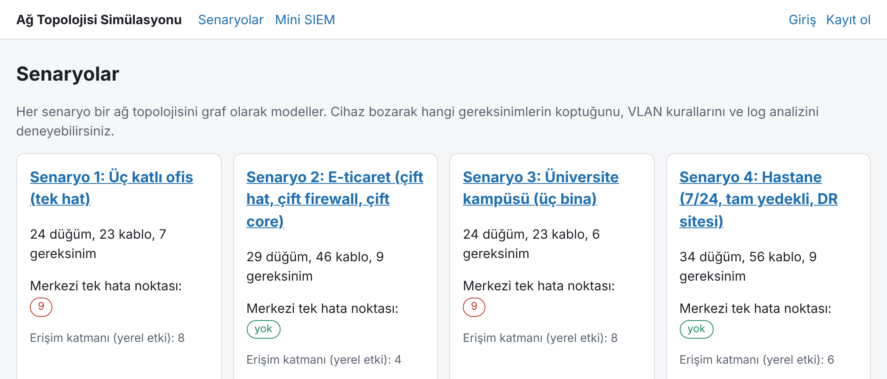

> The scenario names, device labels and web UI text are in Turkish, and so are the module and function names (the code is Turkish-named). A short glossary is in the [Glossary](#glossary) section.

## Architecture

The engine (`ag_motoru/`) is pure Python + NetworkX and independent of Django. The command line uses the engine directly; the web UI and the REST API go through `servis.py`. Scenarios live in the database and `yukle.py` turns them into the engine's graph.

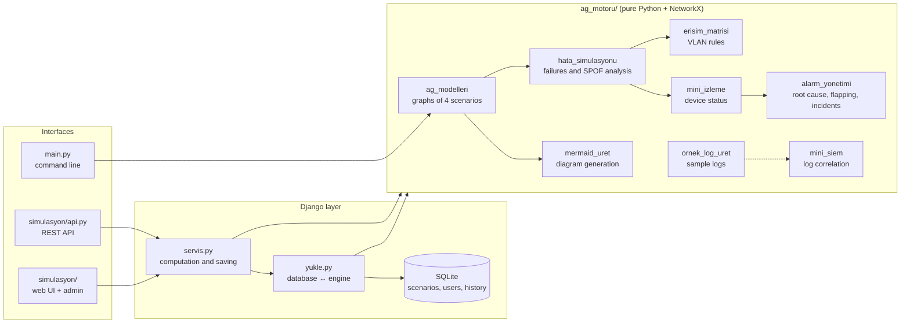

## Setup

Windows PowerShell:

```powershell
py -m venv .venv
.\.venv\Scripts\Activate.ps1
pip install -r requirements.txt
python manage.py migrate                # creates the database (db.sqlite3)
python manage.py seed_senaryolar        # loads the four built-in scenarios into the database
python manage.py createsuperuser        # for the admin panel (optional)
python manage.py runserver
```

Open `http://127.0.0.1:8000` in a browser. `seed_senaryolar` does not change a scenario that already exists (your manual edits are kept); to reset one to its code-defined form, run `python manage.py seed_senaryolar ofis --yenile`. `--yenile` does not delete simulation history. Diagrams are drawn with Mermaid, so the browser needs internet access (the library is loaded from a CDN).

### PostgreSQL (optional)

The default database is SQLite. To use PostgreSQL, install the driver and pass the connection details through environment variables; there is no password in the code:

```powershell
pip install -r requirements-postgres.txt
$env:POSTGRES_PASSWORD = "..."          # your own password
docker compose up -d                    # local PostgreSQL (or your own server)
$env:POSTGRES_DB = "ag_simulasyon"; $env:POSTGRES_USER = "ag"
python manage.py migrate
python manage.py seed_senaryolar
```

`POSTGRES_HOST` (default `localhost`) and `POSTGRES_PORT` (default `5432`) are also read. SQLite is used when `POSTGRES_DB` is not set. The 142 Django tests pass on both databases; to run them on PostgreSQL, set the same environment variables and run `python manage.py test` (the user needs permission to create databases).

## Web interface

| Page | What it does |
|---|---|
| `/` | The four scenarios, with the single-point-of-failure count for each |
| `/senaryo/<slug>/` | Topology diagram, single-point-of-failure table, requirements |
| `/senaryo/<slug>/hata/` | Pick devices or power sources, see what breaks; failed devices turn red in the diagram |
| `/senaryo/<slug>/erisim/` | VLAN matrix, verification of the expected denials, end-to-end query |
| `/senaryo/<slug>/izleme/` | Device states as seen by the monitoring node; root cause and suppressed symptoms |
| `/senaryo/<slug>/zaman/` | Alarm flow over time: pattern, hysteresis, flapping, notifications, incidents |
| `/ariza/` | Saved failure history: durations, open incidents, repair times (login required) |
| `/siem/` | Paste or upload logs, see alarms (sample logs need no login; your own logs require login) |
| `/gecmis/` | The signed-in user's saved simulations |
| `/hesap/giris/`, `/hesap/kayit/` | Login and sign-up |
| `/admin/` | Scenario editing (admin account) |
| `/api/` | REST API |

Slugs of the built-in scenarios: `ofis` (office), `eticaret` (e-commerce), `universite` (university), `hastane` (hospital). A scenario you add in the admin panel opens on the same pages under its own slug.

### Failure simulation

In the hospital scenario, no requirement breaks when `core_1` fails alone; when `core_1` and `core_2` fail together, 8 requirements break. The page also shows failed devices in red in the diagram.

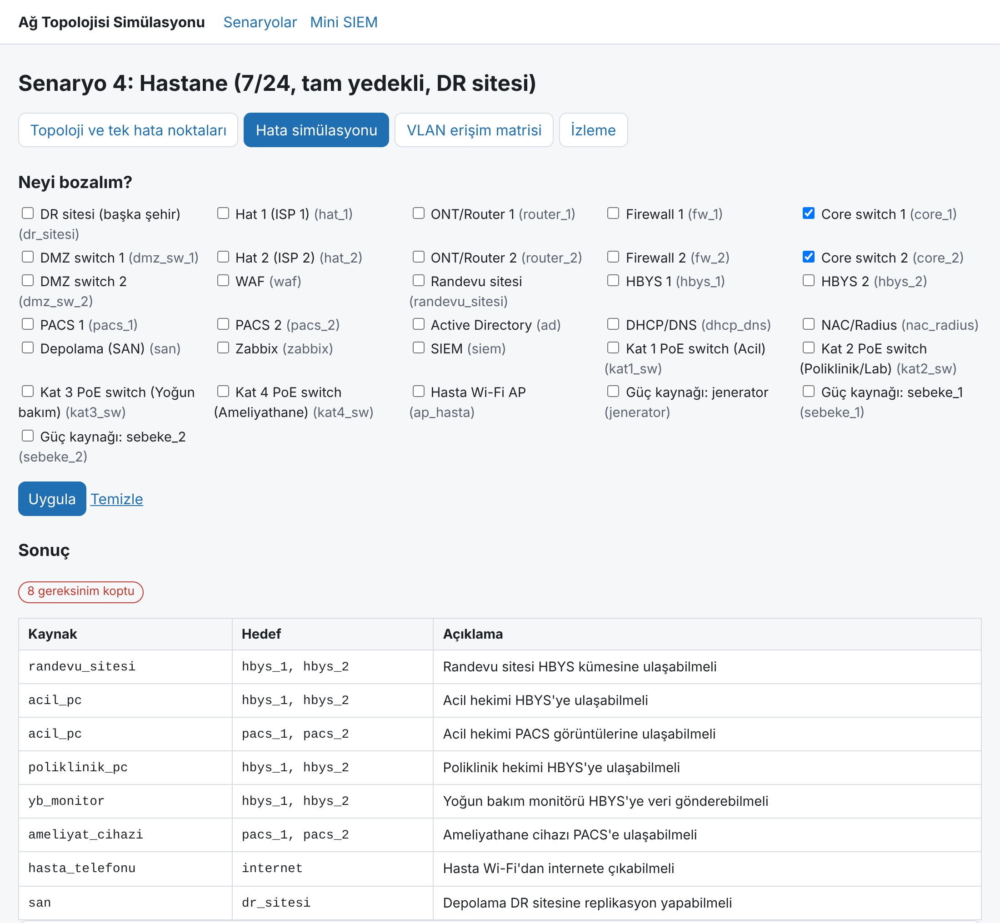

### VLAN access matrix and end-to-end query

There is a cable path from a student device to the student-affairs database, but the policy does not allow it, so the result is ENGEL (blocked).

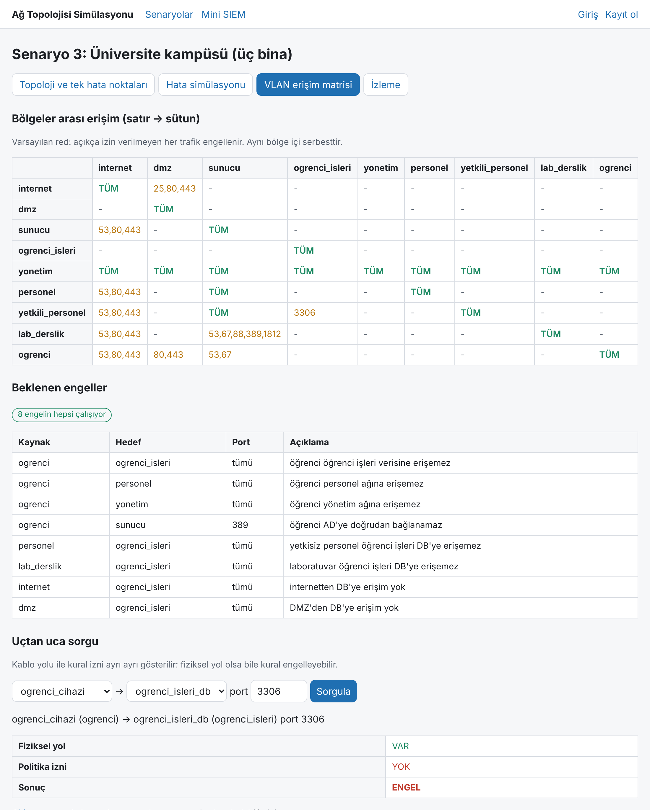

### Mini SIEM

Sample attack log: 212 events, 5 alarms.

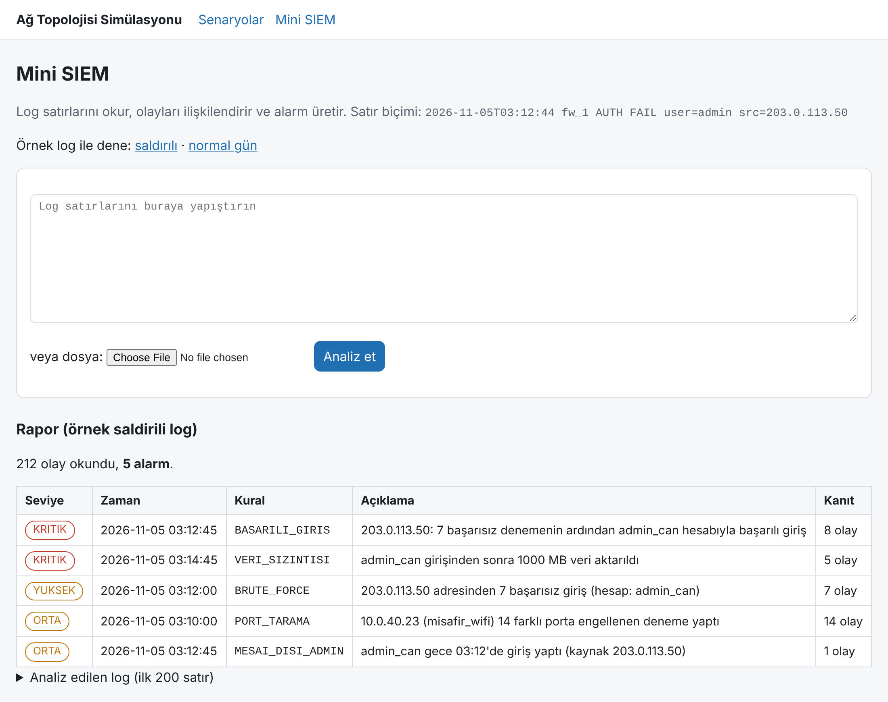

## Alarm management

Three core features of real monitoring systems: **root-cause suppression**, **flapping detection** and **failure history**. Time is measured in checks; a pattern string (`1` = failed, `0` = healthy) says whether the chosen elements are down at each check.

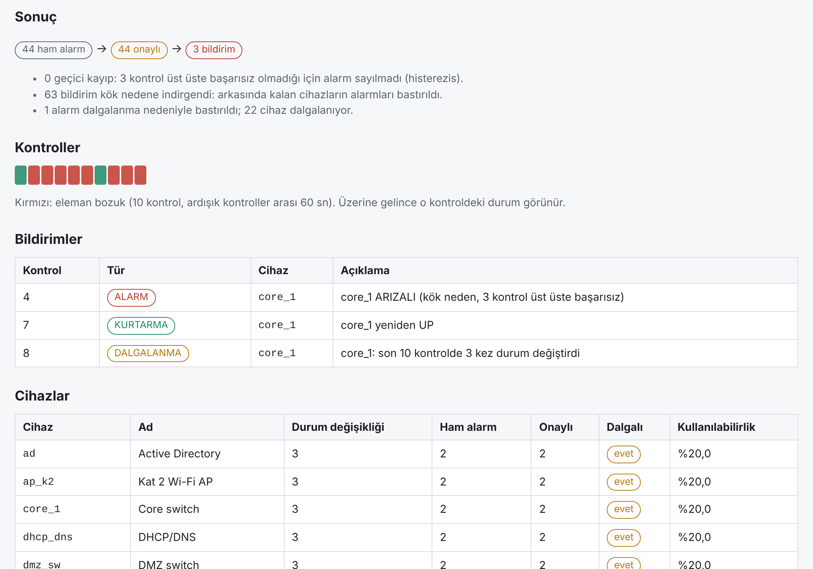

- **Dependency suppression:** when `core_1` goes down, the 21 devices behind it become unreachable too. Instead of alarming on all of them, only the root cause (`core_1`) is notified; the rest are treated as symptoms and suppressed. A device is a symptom when all of its upstream links are down, and a root cause when at least one is healthy (in the dual-core hospital, losing `core_1` and `core_2` together gives two root causes with 30 suppressed symptoms each).
- **Hysteresis:** one failed check does not raise an alarm; it is confirmed after `deneme` (default 3) consecutive failed checks. One-off losses are counted as transient and dropped.
- **Flapping:** a device whose state changes `esik` (3) or more times within the last `pencere` (10) checks is flapping. A flapping root cause produces a single `DALGALANMA` notification instead of one alarm per up/down swing.
- **Notification flow:** `ALARM`, `KURTARMA` (recovery), `DALGALANMA` (flapping). In the office, pattern `0111110111` on `core_1` reduces 44 raw alarms to 3 notifications.

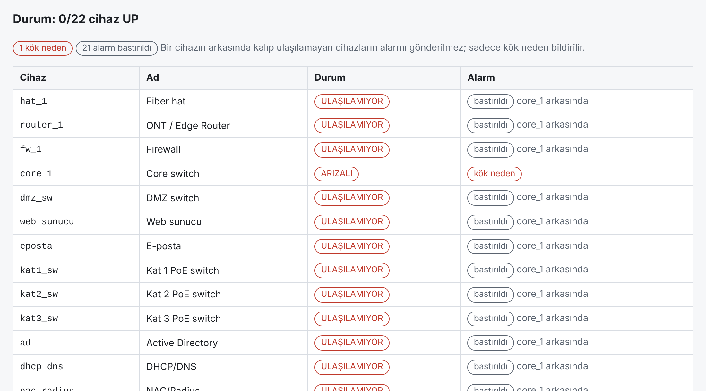

Confirmed failures (incidents) are stored for the signed-in user as `Ariza` records: device, start, duration, open/closed, root cause or symptom, flapping or not. The `/ariza/` page shows, per device, the incident count, total duration, mean time to repair, and open and flapping counts. By default only root causes are listed; "Belirtileri de göster" (show symptoms) reveals the suppressed devices too.

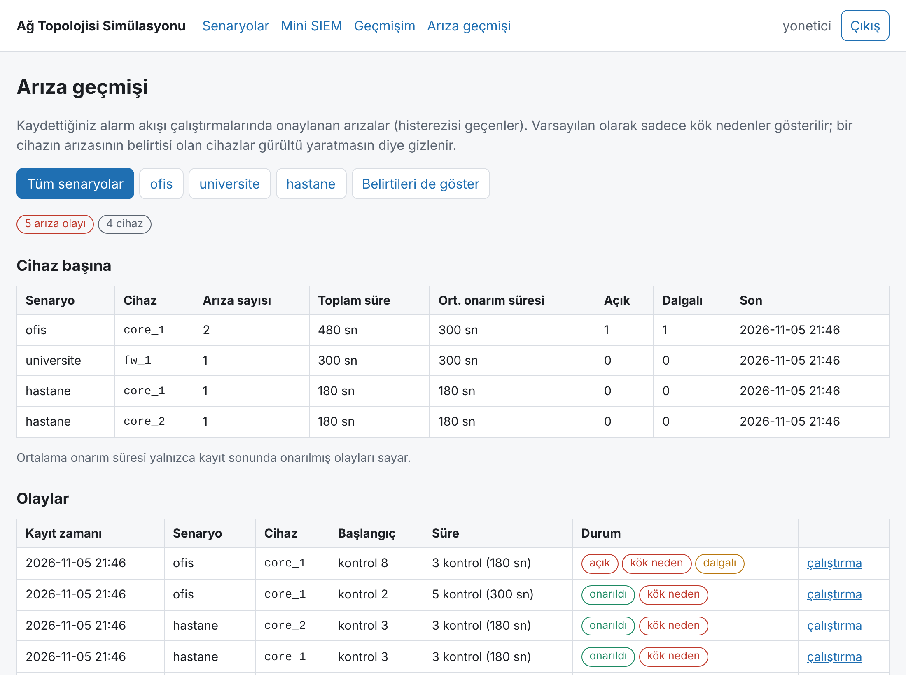

```powershell
python main.py alarm ofis --bozuk core_1 --desen 0111110111
python main.py alarm ofis --bozuk core_1 --desen 0111110111 --deneme 2 --pencere 8 --esik 2 --aralik 30
```

## Database and admin panel

Scenarios live in the database, not in code. Open a scenario under `/admin/` and edit its devices, cables, requirements, allow rules and expected denials on one page; the top of the page shows a single-point-of-failure summary and a list of inconsistencies (a device with no cable, a rule for a zone with no devices, a missing monitoring node).

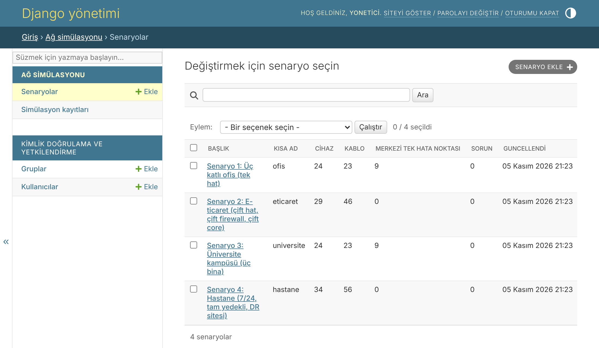

Invalid topology cannot be saved: a device name must start with a lowercase letter and use only `a-z0-9_`, and Mermaid reserved words (`end`, `graph`, ...) are rejected; a device cannot connect to itself, a second cable in the reverse direction cannot be added, only devices of the same scenario can be picked for cables and requirements, and port numbers must be 1-65535. To cable a new device, save the device first, then add the cable.

When the four built-in scenarios are loaded from the database they give exactly the same graph, requirements, rules and analysis results as the code-defined versions (a test verifies this).

## Accounts and history

After signing in, the failure, monitoring and access pages show a **Geçmişe kaydet** (save to history) button. The result is not taken from the client; it is recomputed on the server when saved. When you analyse your own log in the SIEM page, the result is saved automatically (the log itself is not stored, only the source name, line count and alarms). Each user sees and deletes only their own records.

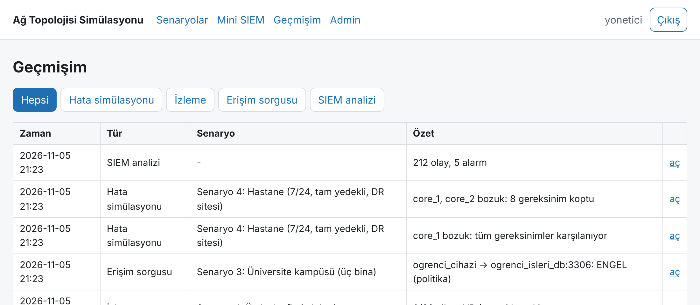

## REST API

Read and compute endpoints are public; saving a result, SIEM analysis and history require login. Authentication is a browser session or HTTP Basic.

| Endpoint | GET | POST |
|---|---|---|
| `/api/senaryolar/` | scenario list and summaries | |
| `/api/senaryolar/<slug>/` | devices, cables, requirements, inconsistencies | |
| `/api/senaryolar/<slug>/analiz/` | single-point-of-failure analysis | |
| `/api/senaryolar/<slug>/diyagram/` | Mermaid text | |
| `/api/senaryolar/<slug>/hata/?bozuk=core_1&bozuk=core_2` | failure simulation | same computation + save to history (login) |
| `/api/senaryolar/<slug>/izleme/?bozuk=...` | monitoring states | same + save (login) |
| `/api/senaryolar/<slug>/erisim/` | VLAN matrix; end-to-end query with `?kaynak=&hedef=&port=` | query + save (login) |
| `/api/senaryolar/<slug>/zaman/?bozuk=core_1&desen=0111110111` | alarm flow (`deneme`, `pencere`, `esik`, `aralik`) | same + save (login); confirmed incidents become `Ariza` |
| `/api/siem/` | | `{"log": "..."}` analyse + save (login) |
| `/api/ariza/`, `/api/ariza/ozet/` | your own incidents (`?senaryo=`, `?cihaz=`, `?acik=1`, `?belirti=1`) and a per-device summary | |
| `/api/gecmis/`, `/api/gecmis/<id>/` | your own records (`?tur=hata`) | DELETE to remove |

An unknown device name or an invalid port returns `400`; an unknown scenario returns `404`.

```powershell
curl.exe http://127.0.0.1:8000/api/senaryolar/
curl.exe "http://127.0.0.1:8000/api/senaryolar/hastane/hata/?bozuk=core_1&bozuk=core_2"
# saving requires login (curl asks for the password)
'{"bozuk": ["core_1", "core_2"]}' | Out-File -Encoding ascii istek.json
curl.exe -u username -X POST -H "Content-Type: application/json" -d "@istek.json" http://127.0.0.1:8000/api/senaryolar/hastane/hata/
```

## Command line

The command line does not use the database; it works on the four built-in scenarios defined in code.

```powershell
python main.py hata hastane                          # single-point-of-failure report
python main.py hata hepsi                            # all scenarios
python main.py hata hastane --bozuk core_1,core_2    # try several failures at once
python main.py erisim universite                     # VLAN matrix
python main.py erisim universite --sorgu ogrenci_cihazi ogrenci_isleri_db 3306
python main.py siem ornek_loglar/saldirili.log
python main.py izleme ofis --bozuk core_1            # root cause and suppressed symptoms
python main.py alarm ofis --bozuk core_1 --desen 0111110111   # alarm flow over time
python main.py diyagram > docs/topolojiler.md        # Mermaid diagrams
python main.py log-uret                              # regenerate sample logs
```

## How it works (step by step)

### 1. The network is a graph

Devices are nodes, cables are edges. Each node has a type (`router`, `firewall`, `core`, `switch`, `sunucu` = server, `istemci` = client...), a zone (VLAN) and the power sources it needs to run. Each scenario also lists its **requirements**:

```
acil_pc  ->  hbys_1 or hbys_2     "ER doctor must be able to reach the HBYS"
```

A requirement with several targets means a cluster: reaching any one of them is enough.

### 2. Failing: remove the node from the graph

A failed device is deleted from the graph. A device also shuts down if **all** of its power sources have failed (in the hospital, no device goes down until `sebeke_1`, `sebeke_2` and `jenerator` are all gone).

### 3. Reachability: breadth-first search

Start at the source and walk to neighbours. One important rule: **servers and clients are end devices, traffic does not pass through them.** Only routers, firewalls and switches can forward traffic. Otherwise a fake "bridge through a server" would appear between two cores.

The diagram below is a simplified excerpt of the hospital scenario (a subgraph of the real graph: an ER doctor PC, the floor 1 switch, two cores and the HBYS servers; HBYS = hospital information system). When `core_1` fails, the path continues through `core_2`:

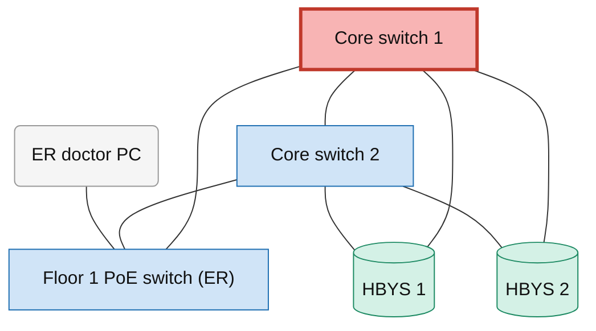

When `core_1` and `core_2` fail together, `kat1_sw` has no neighbour left to go through and `acil_pc` cannot reach the HBYS:

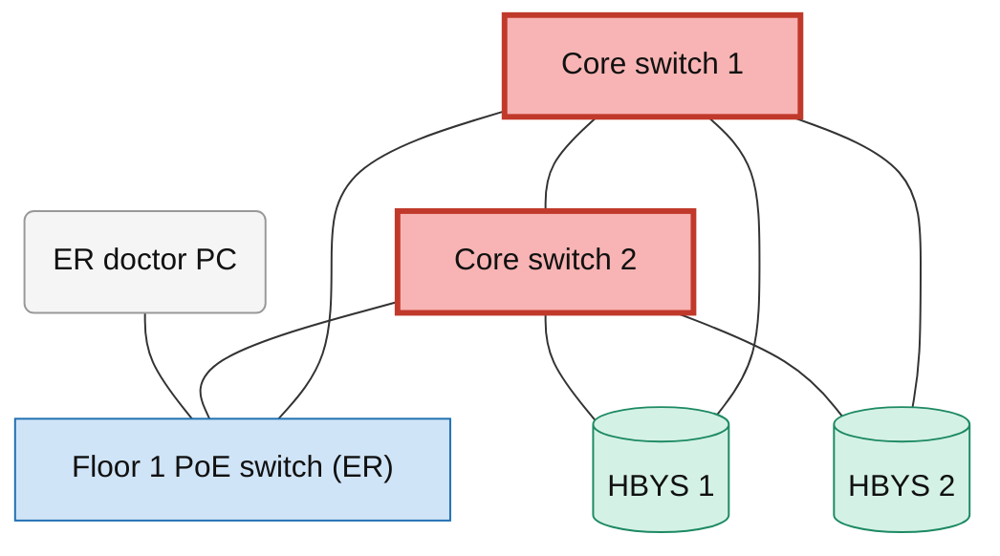

### 4. Single points of failure

Every device, every power source and every cable is failed **one at a time**. If that breaks a requirement, the element is a single point of failure. There are two categories:

- **Central:** firewall, core, line and the like. The failure affects most of the network.
- **Access layer:** floor/building switches and Wi-Fi APs. The failure only affects that floor or building; these are listed separately.

If the failed element is itself an endpoint of the requirement (for example, "PC must reach the internet" breaks when the PC fails), that is not a design flaw and is skipped.

### 5. VLAN access matrix

Rule: `source zone -> target zone, ports`. If no rule matches, traffic is blocked. Traffic inside the same zone is free. The `yonetim -> *` rule lets the management network monitor everything. The matrix of the university scenario (row → column; `ALL` = all ports, numbers = only those ports, `–` = blocked):

| | internet | dmz | sunucu | ogrenci_isleri | yonetim | personel | yetkili_personel | lab_derslik | ogrenci |
|---|---|---|---|---|---|---|---|---|---|
| **internet** | ALL | 25,80,443 | – | – | – | – | – | – | – |
| **dmz** | – | ALL | – | – | – | – | – | – | – |
| **sunucu** | 53,80,443 | – | ALL | – | – | – | – | – | – |
| **ogrenci_isleri** | – | – | – | ALL | – | – | – | – | – |
| **yonetim** | ALL | ALL | ALL | ALL | ALL | ALL | ALL | ALL | ALL |
| **personel** | 53,80,443 | – | ALL | – | – | ALL | – | – | – |
| **yetkili_personel** | 53,80,443 | – | ALL | 3306 | – | – | ALL | – | – |
| **lab_derslik** | 53,80,443 | – | 53,67,88,389,1812 | – | – | – | – | ALL | – |
| **ogrenci** | 53,80,443 | 80,443 | 53,67 | – | – | – | – | – | ALL |

The physical path and the policy are checked separately:

```
$ python main.py erisim universite --sorgu ogrenci_cihazi ogrenci_isleri_db 3306
ogrenci_cihazi (ogrenci) -> ogrenci_isleri_db (ogrenci_isleri) port 3306
  fiziksel yol : VAR      (physical path: exists)
  politika izni: YOK      (policy: not allowed)
  sonuç        : ENGEL    (result: blocked)
```

The cable path exists but the rule blocks it. Putting the database in the internal network instead of the DMZ does not stop students on its own; the VLAN separation and the rule do.

### 6. Mini SIEM: correlating events

Log lines are parsed and rules are applied. The real work is **correlation**: events that look harmless one by one become an attack when combined. The alarm chain for the sample attack log:

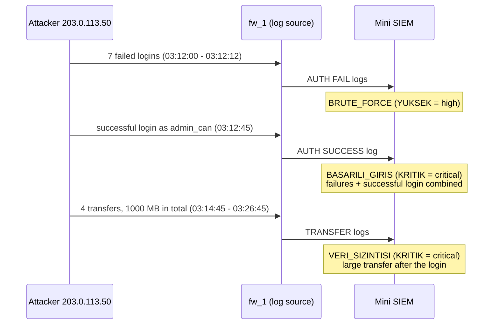

The `VERI_SIZINTISI` (data leak) alarm combines different log types (`AUTH` and `TRANSFER`): it links the login event to the later transfers in a single chain of evidence. There are also `PORT_TARAMA` (port scan) and `MESAI_DISI_ADMIN` (off-hours admin login) rules. Thresholds are changed through the `Esikler` class. Severity levels: `KRITIK` (critical), `YUKSEK` (high), `ORTA` (medium).

### 7. Mini monitoring

The monitoring node (`zabbix`) tries to reach every device. States: `UP`, `ARIZALI` (failed), `GÜÇSÜZ` (no power), `ULAŞILAMIYOR` (unreachable), `İZLEME KAPALI` (monitoring down). `tcp_kontrol(host, port)` also tries a real TCP connection (TCP is used because ping needs administrator rights).

### 8. Alarm management

Element states come from `mini_izleme`; `alarm_yonetimi` adds time and relationships on top.

1. **Upstream nodes.** A BFS from the monitoring node gives every device a level. A device's upstream is its neighbours one level closer that can carry transit traffic (router, firewall, core, switch, ap, hat).
2. **Root cause.** A device that is not `UP` is a root cause if it has no upstream, or at least one upstream is `UP` (`kok_mu = not upstream or any(upstream healthy)`). If all its upstreams are down too it is a symptom and gets suppressed.
3. **Hysteresis.** A consecutive-failure counter is kept per device; the incident is confirmed when it reaches `deneme`.
4. **Flapping.** 0/1 transitions are counted over the last `pencere` checks; reaching `esik` marks the device as flapping.
5. **Incident record.** Each incident has a start, an end and a duration (`sure * aralik_sn`); with no end the failure is still open.

Time is a check count, not wall-clock time; the seconds equivalent is given by `aralik_sn`.

## Findings

Results when everything is failed one at a time in the four scenarios:

| Scenario | Nodes | Cables | Failures tried | Central single points of failure | Access layer |
|---|---|---|---|---|---|
| Office (single line) | 24 | 23 | 42 | **9** | 8 |
| E-commerce (dual line/firewall/core) | 29 | 46 | 72 | **0** | 4 |
| University (three buildings) | 24 | 23 | 43 | **9** | 8 |
| Hospital (fully redundant, DR site) | 34 | 56 | 87 | **0** | 6 |

Two lessons from the modelling:

1. **The DMZ switch can be a single point of failure too.** In the office and university scenarios `dmz_sw` shows up in the list: when the only DMZ switch fails, access to the website breaks. That is why the DMZ switch is doubled (`dmz_sw_1`, `dmz_sw_2`) in the e-commerce and hospital scenarios.
2. **The monitoring system needs a redundant position too.** In the office and university scenarios Zabbix sits behind a single core; when that core fails, monitoring goes completely blind (`0/22 devices UP`, even though the firewall is running). In the hospital and e-commerce scenarios Zabbix is connected to both cores and keeps seeing everything when one core fails.

On the power side: if you build the office with `ofis(jenerator=False)` (no generator), `sebeke` (mains power) appears as a central single point of failure.

## Limitations

- The service provider's own network is not modelled; "internet" is a single cloud node.
- The WAF is modelled as an end device in the DMZ that traffic does not pass through; IPS/IDS is not a separate node but a feature of the firewall. So a WAF failure or an IPS blocking traffic is not part of the SPOF analysis.
- Server redundancy is only measured where a requirement lists several targets (a cluster, such as HBYS/PACS in the hospital). If a single-target server (such as `veritabani` in e-commerce) fails, it is not reported as a design flaw.
- The power model is "any one source is enough"; there is no time dimension such as UPS runtime or ATS delay.
- VLAN policy works at zone level; there are no per-device rules.
- In alarm management time is a check count, not wall-clock time; the failure pattern is typed in, nothing is measured from a real network. The root cause is found from topological proximity; routing protocols are not modelled.
- SIEM thresholds are sample values and must be tuned to the traffic of a real network.
- The web interface and API are for local use: `SECRET_KEY` is a development key, anyone can sign up, HTTP Basic credentials are sent unencrypted and there is no rate limiting. In any other environment, set `DJANGO_SECRET_KEY`, `DJANGO_DEBUG=0` and `ALLOWED_HOSTS`, and run behind HTTPS.
- The command line uses the four code-defined scenarios, not the ones in the database; edits made in the admin panel do not show up there.

## Project structure

```
ag_motoru/                 simulation engine, independent of Django
  ag_modelleri.py          graphs, requirements and VLAN rules of the four scenarios
  hata_simulasyonu.py      single-point-of-failure analysis, multiple failures
  erisim_matrisi.py        VLAN matrix, end-to-end query
  mini_siem.py             log parsing, correlation, alarms
  mini_izleme.py           monitoring state, TCP check
  alarm_yonetimi.py        root-cause suppression, hysteresis, flapping, incidents
  mermaid_uret.py          Mermaid diagram from the graph
  ornek_log_uret.py        sample log generator
requirements-postgres.txt  PostgreSQL driver (optional)
docker-compose.yml         local PostgreSQL
simulasyon/                Django app
  models.py                scenario, device, cable, requirement, rule, denial, simulation history, failure records
  yukle.py                 database <-> engine conversion
  servis.py                computation and saving to history (shared by web and API)
  views.py, urls.py        web pages, login/sign-up, history
  api.py, api_urls.py      REST API
  admin.py                 scenario editing panel
  management/commands/     seed_senaryolar command
  templates/, tests/       templates and tests
config/                    Django settings
tests/                     engine tests (pytest)
ornek_loglar/              normal.log, saldirili.log
docs/topolojiler.md        diagrams of the four scenarios
docs/img/                  README screenshots
main.py                    command-line interface
```

## Tests

```powershell
python -m pytest -q          # engine: 104 tests
python manage.py test        # web, admin, API, accounts and database: 142 tests
```

The tests also verify architectural expectations such as "no central single point of failure in the redundant scenarios", "it breaks when both cores fail", "cable path exists but the policy blocks it" and "no transit through servers".

## Glossary

| Term in the code | Meaning |
|---|---|
| `ofis`, `eticaret`, `universite`, `hastane` | office, e-commerce, university, hospital |
| `hata`, `bozuk` | failure, failed |
| `erisim` | access |
| `izleme` | monitoring |
| `sunucu`, `istemci` | server, client |
| `sebeke`, `jenerator` | mains power, generator |
| `ogrenci_isleri` | student affairs |
| HBYS, PACS | hospital information system, medical image archive |
| `KRITIK`, `YUKSEK`, `ORTA` | critical, high, medium |

## Hospital topology

For the other three scenarios see [docs/topolojiler.md](docs/topolojiler.md).

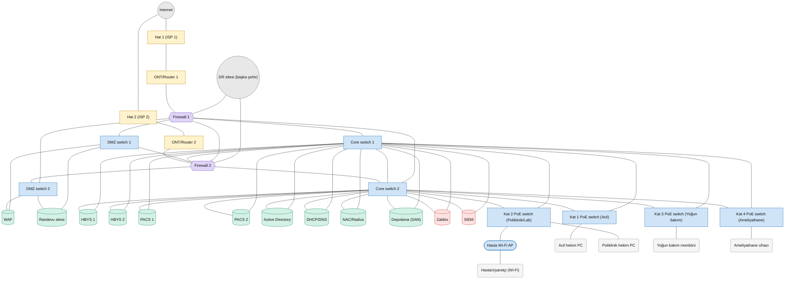
