# Ağ Topolojisi Simülasyonu

**Türkçe** · [English](README.en.md)

Ağ mimarilerini (ofis, e-ticaret, üniversite, hastane) **graf olarak modelleyen** ve üzerinde şunları deneyen bir Python projesi:

- **Hata simülasyonu:** bir cihaz, kablo ya da güç kaynağı bozulursa hangi erişimler kopar? Tek hata noktaları (SPOF) hangileri?
- **VLAN erişim matrisi:** hangi bölge hangi bölgeye hangi portla erişebilir? Varsayılan red mantığıyla.
- **Mini SIEM:** farklı cihazların loglarını okur, olayları ilişkilendirir, alarm üretir.
- **Mini izleme:** Zabbix mantığıyla, izleme düğümü her cihaza ulaşabiliyor mu?
- **Django web arayüzü:** hepsini tarayıcıdan dener, diyagramı çizer, bozulan cihazı kırmızı gösterir.
- **Veritabanı ve admin paneli:** topoloji, kablolar, gereksinimler, VLAN kuralları SQLite'ta tutulur; admin panelinden düzenlenir, yeni senaryo eklenir.
- **Hesaplar ve geçmiş:** kayıt/giriş vardır; çalıştırılan simülasyonlar kullanıcıya özel geçmişe kaydedilir.
- **REST API:** aynı hesaplamalar JSON olarak (Django REST framework).

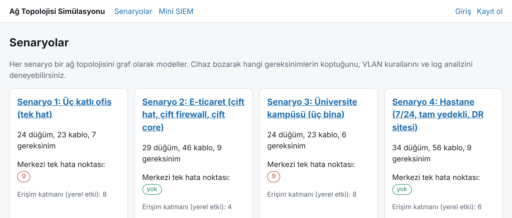

## Mimari

Motor (`ag_motoru/`) Django'dan bağımsız saf Python + NetworkX'tir. Komut satırı motoru doğrudan, web arayüzü ve REST API ise `servis.py` üzerinden kullanır; senaryolar veritabanında durur ve `yukle.py` ile motorun grafına çevrilir.

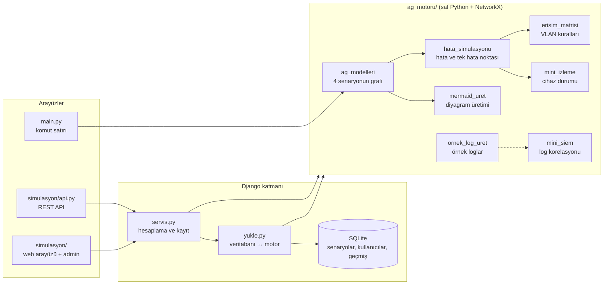

## Kurulum

Windows PowerShell:

```powershell
py -m venv .venv
.\.venv\Scripts\Activate.ps1
pip install -r requirements.txt
python manage.py migrate                # veritabanını (db.sqlite3) oluşturur
python manage.py seed_senaryolar        # dört yerleşik senaryoyu veritabanına yükler
python manage.py createsuperuser        # admin paneli için (isteğe bağlı)
python manage.py runserver
```

Tarayıcıda `http://127.0.0.1:8000` açılır. `seed_senaryolar` var olan senaryoyu değiştirmez (elle yaptığınız düzenlemeler korunur); kodla yazılmış hâline döndürmek için `python manage.py seed_senaryolar ofis --yenile` çalıştırın. Simülasyon geçmişi `--yenile` ile silinmez. Diyagramlar Mermaid ile çizildiği için tarayıcının internete erişebilmesi gerekir (kütüphane CDN'den yüklenir).

## Web arayüzü

| Sayfa | Ne yapar |
|---|---|
| `/` | Dört senaryo, her biri için tek hata noktası sayısı |
| `/senaryo/<kisa-ad>/` | Topoloji diyagramı, tek hata noktası tablosu, gereksinimler |
| `/senaryo/<kisa-ad>/hata/` | Cihaz/güç kaynağı seç, bozulunca ne koptuğunu gör; bozulanlar diyagramda kırmızı |
| `/senaryo/<kisa-ad>/erisim/` | VLAN matrisi, beklenen engellerin doğrulaması, uçtan uca sorgu |
| `/senaryo/<kisa-ad>/izleme/` | İzleme düğümü gözüyle cihaz durumları |
| `/siem/` | Log yapıştır ya da yükle, alarmları gör (örnek loglar giriş gerektirmez; kendi logunuz için giriş gerekir) |
| `/gecmis/` | Giriş yapan kullanıcının kayıtlı simülasyonları |
| `/hesap/giris/`, `/hesap/kayit/` | Giriş ve kayıt |
| `/admin/` | Senaryo düzenleme (yönetici hesabı) |
| `/api/` | REST API |

Yerleşik senaryoların kısa adları: `ofis`, `eticaret`, `universite`, `hastane`. Admin panelinden eklediğiniz senaryo da kendi kısa adıyla aynı sayfalarda açılır.

### Hata simülasyonu

Hastane senaryosunda `core_1` tek başına bozulunca hiçbir gereksinim kopmaz; `core_1` ve `core_2` birlikte bozulunca 8 gereksinim kopar. Sayfada bozulan cihazlar ayrıca diyagramda kırmızı gösterilir.

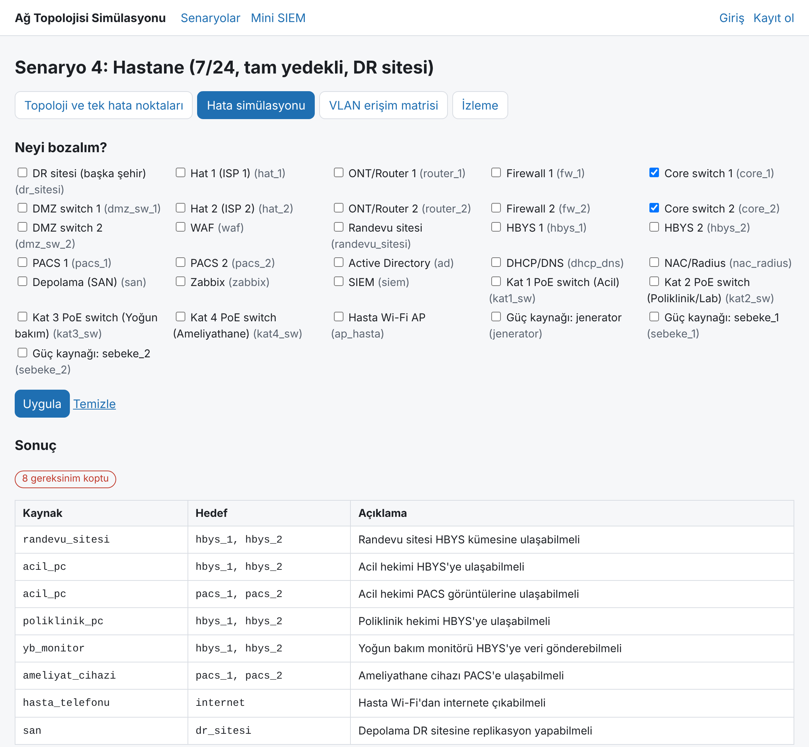

### VLAN erişim matrisi ve uçtan uca sorgu

Öğrenci cihazından öğrenci işleri veritabanına kablo yolu vardır ama politika izin vermez; sonuç ENGEL'dir.

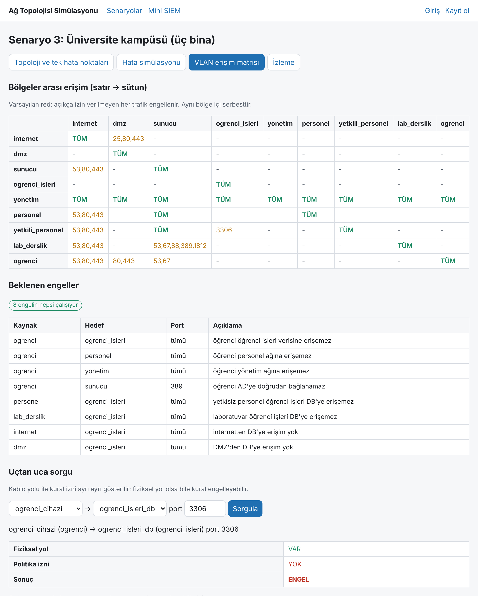

### Mini SIEM

Saldırılı örnek log: 212 olay, 5 alarm.

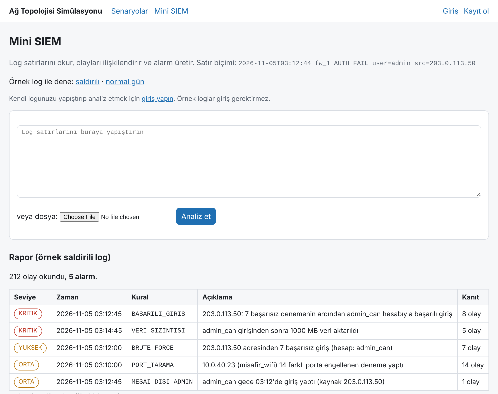

## Veritabanı ve admin paneli

Senaryolar kodda değil veritabanında durur. `/admin/` altında bir senaryoyu açınca cihazlar, kablolar, gereksinimler, izin kuralları ve beklenen engeller tek sayfada düzenlenir; sayfanın üstünde tek hata noktası özeti ve tutarsızlık listesi (bağlantısız cihaz, olmayan bölgeye kural, olmayan izleme düğümü) görünür.

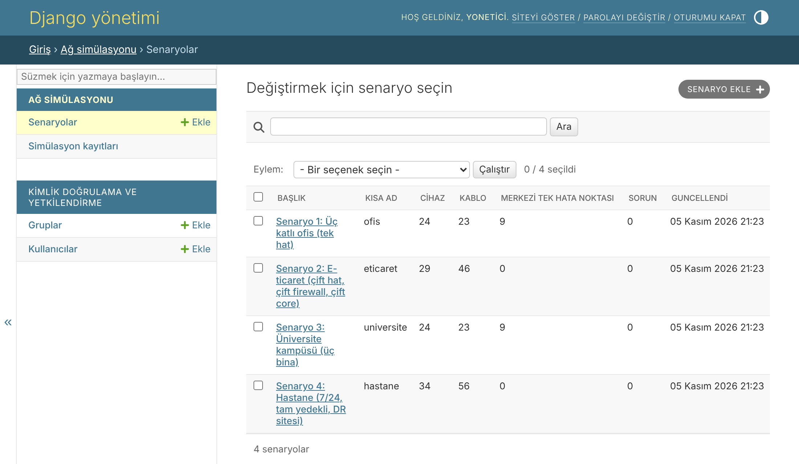

Hatalı topoloji kayda girmez: cihaz adı küçük harfle başlayan `a-z0-9_` olmalıdır ve Mermaid'in ayrılmış sözcükleri (`end`, `graph`, ...) yasaktır; bir cihaz kendine bağlanamaz, ters yönde ikinci kablo eklenemez, kablo ve gereksinimde yalnızca aynı senaryonun cihazları seçilebilir; port numaraları 1-65535 olmalıdır. Yeni bir cihaza kablo bağlamak için önce cihazı kaydedin, sonra kablo ekleyin.

Yerleşik dört senaryo, veritabanından yüklendiğinde kodla yazılmış hâliyle birebir aynı graf, gereksinim, kural ve analiz sonucunu verir (bu bir testle doğrulanır).

## Hesaplar ve geçmiş

Kayıt olup giriş yapınca hata, izleme ve erişim sayfalarında **Geçmişe kaydet** düğmesi görünür. Kayıt sırasında sonuç istemciden alınmaz, sunucuda yeniden hesaplanır. SIEM'de kendi logunuzu analiz ettiğinizde sonuç otomatik kaydedilir (logun kendisi saklanmaz, yalnızca kaynak adı, satır sayısı ve alarmlar). Her kullanıcı yalnızca kendi kayıtlarını görür ve silebilir.

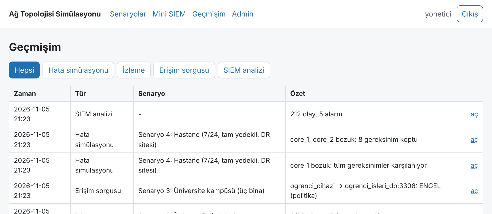

## REST API

Okuma ve hesaplama uçları herkese açıktır; sonucu kaydetmek, SIEM analizi ve geçmiş giriş ister. Giriş için tarayıcı oturumu ya da HTTP Basic kullanılır.

| Uç | GET | POST |
|---|---|---|
| `/api/senaryolar/` | senaryo listesi ve özetleri | |
| `/api/senaryolar/<kisa-ad>/` | cihazlar, kablolar, gereksinimler, tutarsızlıklar | |
| `/api/senaryolar/<kisa-ad>/analiz/` | tek hata noktası analizi | |
| `/api/senaryolar/<kisa-ad>/diyagram/` | Mermaid metni | |
| `/api/senaryolar/<kisa-ad>/hata/?bozuk=core_1&bozuk=core_2` | hata simülasyonu | aynı hesap + geçmişe kaydet (giriş) |
| `/api/senaryolar/<kisa-ad>/izleme/?bozuk=...` | izleme durumları | aynı + kaydet (giriş) |
| `/api/senaryolar/<kisa-ad>/erisim/` | VLAN matrisi; `?kaynak=&hedef=&port=` ile uçtan uca sorgu | sorgu + kaydet (giriş) |
| `/api/siem/` | | `{"log": "..."}` analiz + kaydet (giriş) |
| `/api/gecmis/`, `/api/gecmis/<id>/` | kendi kayıtların (`?tur=hata`) | DELETE ile silme |

Bilinmeyen cihaz adı ya da geçersiz port `400` döner; bilinmeyen senaryo `404`.

```powershell
curl.exe http://127.0.0.1:8000/api/senaryolar/
curl.exe "http://127.0.0.1:8000/api/senaryolar/hastane/hata/?bozuk=core_1&bozuk=core_2"
# kaydetmek için giriş gerekir (parolayı curl sorar)
'{"bozuk": ["core_1", "core_2"]}' | Out-File -Encoding ascii istek.json
curl.exe -u kullanici -X POST -H "Content-Type: application/json" -d "@istek.json" http://127.0.0.1:8000/api/senaryolar/hastane/hata/
```

## Komut satırı

Komut satırı veritabanını kullanmaz; kodla yazılmış dört yerleşik senaryo üzerinde çalışır.

```powershell
python main.py hata hastane                          # tek hata noktası raporu
python main.py hata hepsi
python main.py hata hastane --bozuk core_1,core_2    # birden fazla hatayı aynı anda dene
python main.py erisim universite                     # VLAN matrisi
python main.py erisim universite --sorgu ogrenci_cihazi ogrenci_isleri_db 3306
python main.py siem ornek_loglar/saldirili.log
python main.py izleme ofis --bozuk core_1
python main.py diyagram > docs/topolojiler.md        # Mermaid diyagramları
python main.py log-uret                              # örnek logları yeniden üret
```

## Nasıl çalışır (adım adım)

### 1. Ağ bir graftır

Cihazlar düğüm, kablolar kenardır. Her düğümün bir türü (`router`, `firewall`, `core`, `switch`, `sunucu`, `istemci`...), bir bölgesi (VLAN) ve çalışması için gereken güç kaynakları vardır. Her senaryo ayrıca **gereksinimleri** listeler:

```
acil_pc  ->  hbys_1 veya hbys_2     "Acil hekimi HBYS'ye ulaşabilmeli"
```

Hedef birden fazlaysa küme demektir: ikisinden birine ulaşmak yeter.

### 2. Bozma: düğümü graftan çıkar

Bozulan cihaz graftan silinir. Bir cihazın **bütün** güç kaynakları bozulursa o cihaz da kapanır (hastanede `sebeke_1`, `sebeke_2` ve `jenerator` üçü birden gitmeden hiçbir cihaz kapanmaz).

### 3. Ulaşılabilirlik: genişlik öncelikli arama

Kaynaktan başlanır, komşulara gidilir. Önemli kural: **sunucu ve istemciler uç cihazdır, trafik içlerinden geçmez.** Sadece router, firewall, switch gibi cihazlar geçiş yapabilir. Aksi halde iki core arasında "sunucu üzerinden" sahte bir köprü oluşurdu.

Aşağıdaki şema hastane senaryosundan alınmış sadeleştirilmiş bir parçadır (gerçek grafın alt grafı: acil hekim PC'si, kat 1 switch'i, iki core ve HBYS sunucuları). `core_1` bozulunca yol `core_2` üzerinden sürer:

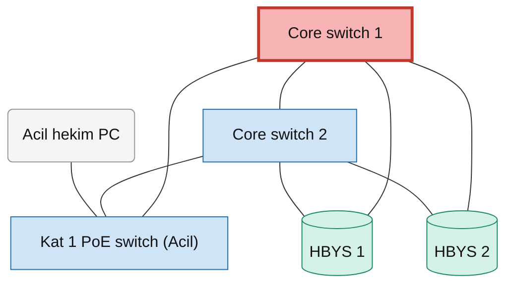

`core_1` ve `core_2` birlikte bozulunca `kat1_sw`'nin gidecek komşusu kalmaz, `acil_pc` HBYS'ye ulaşamaz:

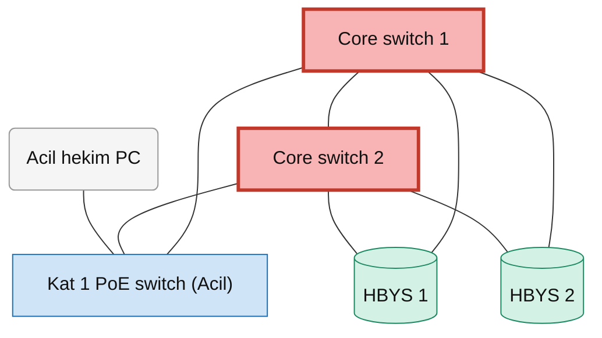

### 4. Tek hata noktası

Her cihaz, her güç kaynağı ve her kablo **tek tek** bozulur. Bir gereksinimi koparıyorsa o eleman tek hata noktasıdır. İki ayrım yapılır:

- **Merkezi:** firewall, core, hat gibi. Bozulunca ağın büyük kısmı etkilenir.
- **Erişim katmanı:** kat/bina switch'i ve Wi-Fi AP. Bozulunca sadece o kat/bina etkilenir; ayrı listelenir.

Bozulan elemanın kendisi gereksinimin uç noktasıysa (örn. PC bozulunca "PC internete çıkabilmeli" kopar) bu tasarım hatası sayılmaz, atlanır.

### 5. VLAN erişim matrisi

Kural: `kaynak bölge -> hedef bölge, portlar`. Eşleşen kural yoksa trafik engellenir. Aynı bölge içi serbesttir. `yonetim -> *` kuralı yönetim ağının her yeri izlemesini sağlar. Üniversite senaryosunun matrisi (satır → sütun; `TÜM` = bütün portlar, sayılar = sadece o portlar, `–` = engel):

| | internet | dmz | sunucu | ogrenci_isleri | yonetim | personel | yetkili_personel | lab_derslik | ogrenci |
|---|---|---|---|---|---|---|---|---|---|
| **internet** | TÜM | 25,80,443 | – | – | – | – | – | – | – |
| **dmz** | – | TÜM | – | – | – | – | – | – | – |
| **sunucu** | 53,80,443 | – | TÜM | – | – | – | – | – | – |
| **ogrenci_isleri** | – | – | – | TÜM | – | – | – | – | – |
| **yonetim** | TÜM | TÜM | TÜM | TÜM | TÜM | TÜM | TÜM | TÜM | TÜM |
| **personel** | 53,80,443 | – | TÜM | – | – | TÜM | – | – | – |
| **yetkili_personel** | 53,80,443 | – | TÜM | 3306 | – | – | TÜM | – | – |
| **lab_derslik** | 53,80,443 | – | 53,67,88,389,1812 | – | – | – | – | TÜM | – |
| **ogrenci** | 53,80,443 | 80,443 | 53,67 | – | – | – | – | – | TÜM |

Fiziksel yol ile politika ayrı kontrol edilir:

```
$ python main.py erisim universite --sorgu ogrenci_cihazi ogrenci_isleri_db 3306
ogrenci_cihazi (ogrenci) -> ogrenci_isleri_db (ogrenci_isleri) port 3306
  fiziksel yol : VAR
  politika izni: YOK
  sonuç        : ENGEL
```

Kablo yolu vardır ama kural engeller. Veritabanını DMZ'ye değil iç ağa koymak tek başına öğrenciyi durdurmaz; durduran VLAN ayrımı ve kuraldır.

### 6. Mini SIEM: olayları ilişkilendirme

Log satırları ayrıştırılır, kurallar uygulanır. Asıl iş **korelasyondur**: tek tek masum görünen olaylar birleşince saldırı olur. Örnek saldırılı logda alarm zinciri:

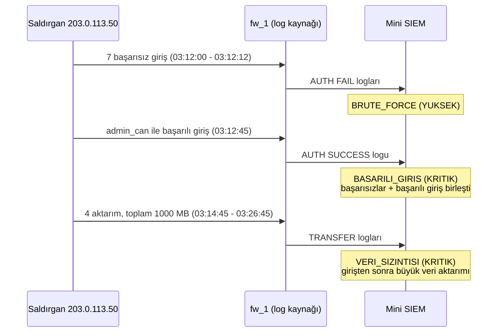

`VERI_SIZINTISI` alarmı farklı log türlerini (`AUTH` ve `TRANSFER`) birleştirir: giriş olayı ile sonraki veri aktarımlarını tek kanıt zincirine bağlar. Ayrıca `PORT_TARAMA` ve `MESAI_DISI_ADMIN` kuralları vardır. Eşikler `Esikler` sınıfından değiştirilir. Seviyeler: `KRITIK`, `YUKSEK`, `ORTA`.

### 7. Mini izleme

İzleme düğümü (`zabbix`) her cihaza ulaşmayı dener. Durumlar: `UP`, `ARIZALI`, `GÜÇSÜZ`, `ULAŞILAMIYOR`, `İZLEME KAPALI`. Ayrıca `tcp_kontrol(host, port)` gerçek bir TCP bağlantısı dener (ping yönetici yetkisi istediği için TCP kullanılır).

## Bulgular

Dört senaryoda her şey tek tek bozulunca çıkan sonuçlar:

| Senaryo | Düğüm | Kablo | Denenen hata | Merkezi tek hata noktası | Erişim katmanı |
|---|---|---|---|---|---|
| Ofis (tek hat) | 24 | 23 | 42 | **9** | 8 |
| E-ticaret (çift hat/firewall/core) | 29 | 46 | 72 | **0** | 4 |
| Üniversite (üç bina) | 24 | 23 | 43 | **9** | 8 |
| Hastane (tam yedekli, DR) | 34 | 56 | 87 | **0** | 6 |

Modelleme sırasında çıkan iki ders:

1. **DMZ switch'i de tek hata noktası olabilir.** Ofis ve üniversitede `dmz_sw` listede çıkar: tek DMZ switch'i bozulunca web sitesine erişim kopar. Bu yüzden e-ticaret ve hastanede DMZ switch'i de çift (`dmz_sw_1`, `dmz_sw_2`) modellendi.
2. **İzleme sistemi de yedekli konumlanmalı.** Ofis ve üniversitede Zabbix tek core'un arkasında durur; core bozulunca izleme tamamen kör kalır (`0/22 cihaz UP`, firewall çalışıyor olsa bile). Hastane ve e-ticaretteki Zabbix iki core'a da bağlıdır, tek core düşünce her şeyi görmeye devam eder.

Güç tarafı: `ofis(jenerator=False)` ile jeneratörsüz ofis kurulursa `sebeke` merkezi tek hata noktası olarak listeye girer.

## Sınırlamalar

- Servis sağlayıcının kendi ağı modellenmez; "internet" tek bir bulut düğümüdür.
- WAF, DMZ'de trafiğin içinden geçmeyen uç cihaz olarak modellenir; IPS/IDS ise ayrı bir düğüm değil firewall'ın özelliğidir. Bu yüzden WAF'ın arızası ya da IPS'in trafiği kesmesi SPOF analizine girmez.
- Sunucu yedekliliği sadece gereksinimde birden fazla hedef (küme) listelenmişse ölçülür (hastanede HBYS/PACS). Tek hedefli sunucu (örn. e-ticaretteki `veritabani`) bozulursa bu bir tasarım hatası olarak raporlanmaz.
- Güç modeli "kaynaklardan biri yeter" mantığındadır; UPS'in dayanma süresi, ATS gecikmesi gibi zaman boyutu yoktur.
- VLAN politikası bölge düzeyindedir; cihaz bazında kural yoktur.
- SIEM eşikleri örnek değerlerdir, gerçek bir ağın trafiğine göre ayarlanmalıdır.
- Web arayüzü ve API yerel kullanım içindir: `SECRET_KEY` geliştirme anahtarıdır, herkes kayıt olabilir, HTTP Basic kimlik bilgisi şifrelenmeden gider ve istek sınırlaması yoktur. Başka bir ortamda `DJANGO_SECRET_KEY`, `DJANGO_DEBUG=0` ve `ALLOWED_HOSTS` ayarlarıyla, HTTPS arkasında çalıştırın.
- Komut satırı veritabanındaki senaryoları değil, kodla yazılmış dört senaryoyu kullanır; admin panelinde yapılan düzenleme komut satırına yansımaz.

## Proje yapısı

```
ag_motoru/                 Django'dan bağımsız simülasyon motoru
  ag_modelleri.py          dört senaryonun grafı, gereksinimleri, VLAN kuralları
  hata_simulasyonu.py      tek hata noktası analizi, çoklu hata
  erisim_matrisi.py        VLAN matrisi, uçtan uca sorgu
  mini_siem.py             log ayrıştırma, korelasyon, alarm
  mini_izleme.py           izleme durumu, TCP kontrolü
  mermaid_uret.py          graftan Mermaid diyagramı
  ornek_log_uret.py        örnek log üretici
simulasyon/                Django uygulaması
  models.py                senaryo, cihaz, kablo, gereksinim, kural, engel, simülasyon geçmişi
  yukle.py                 veritabanı <-> motor dönüşümü
  servis.py                hesaplama ve geçmişe kayıt (web ve API ortak kullanır)
  views.py, urls.py        web sayfaları, giriş/kayıt, geçmiş
  api.py, api_urls.py      REST API
  admin.py                 senaryo düzenleme paneli
  management/commands/     seed_senaryolar komutu
  templates/, tests/       şablonlar ve testler
config/                    Django ayarları
tests/                     motor testleri (pytest)
ornek_loglar/              normal.log, saldirili.log
docs/topolojiler.md        dört senaryonun diyagramları
docs/img/                  README ekran görüntüleri
main.py                    komut satırı arayüzü
```

## Testler

```powershell
python -m pytest -q          # motor: 60 test
python manage.py test        # web, admin, API, hesap ve veritabanı: 106 test
```

Testler ayrıca "yedekli senaryoda merkezi tek hata noktası yok", "iki core birden düşünce kopar", "kablo yolu var ama politika engeller", "sunucu içinden geçiş yok" gibi mimari beklentileri doğrular.

## Hastane topolojisi

Diğer üç senaryo için bkz. [docs/topolojiler.md](docs/topolojiler.md).

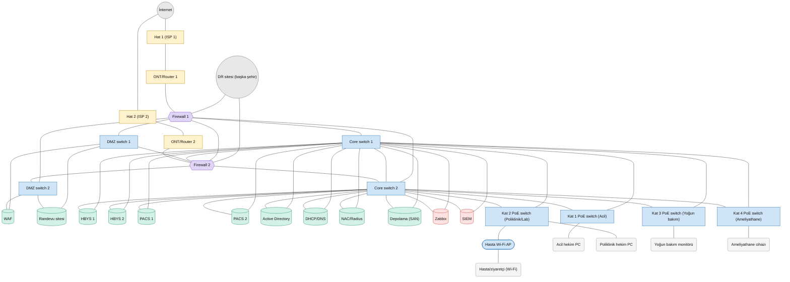
