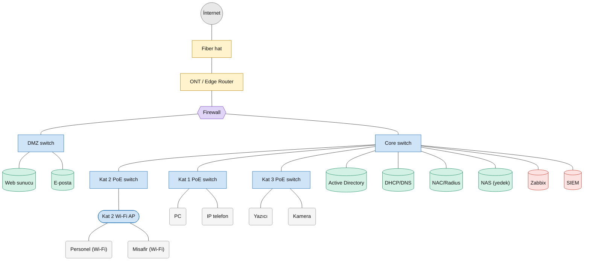
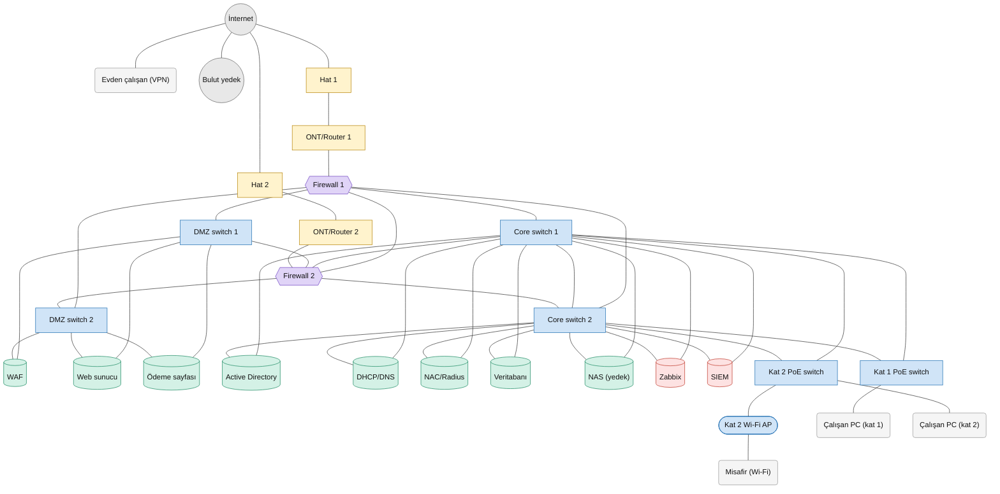
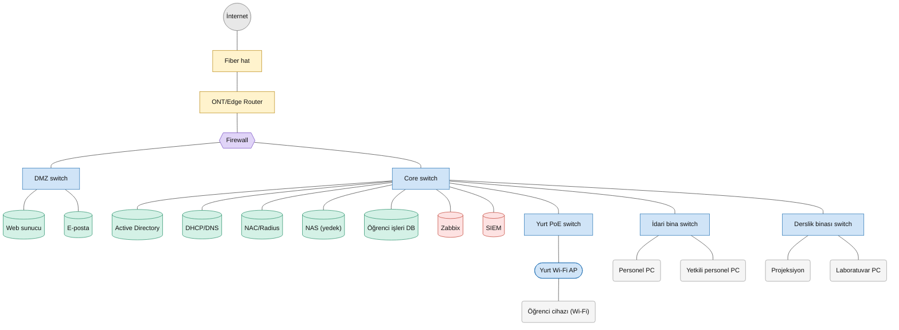
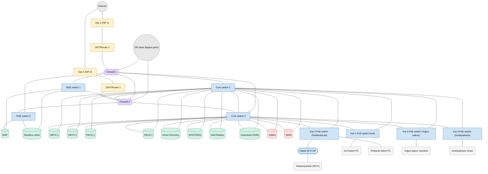

# Ağ topolojileri

Bu dosya `python main.py diyagram` komutuyla modelden otomatik üretilir.
Yuvarlak: internet/dış, dörtgen: ağ cihazı, altıgen: firewall, silindir: sunucu, yuvarlak köşeli: uç cihaz.

## Senaryo 1: Üç katlı ofis (tek hat)

## Senaryo 2: E-ticaret (çift hat, çift firewall, çift core)

## Senaryo 3: Üniversite kampüsü (üç bina)

## Senaryo 4: Hastane (7/24, tam yedekli, DR sitesi)

